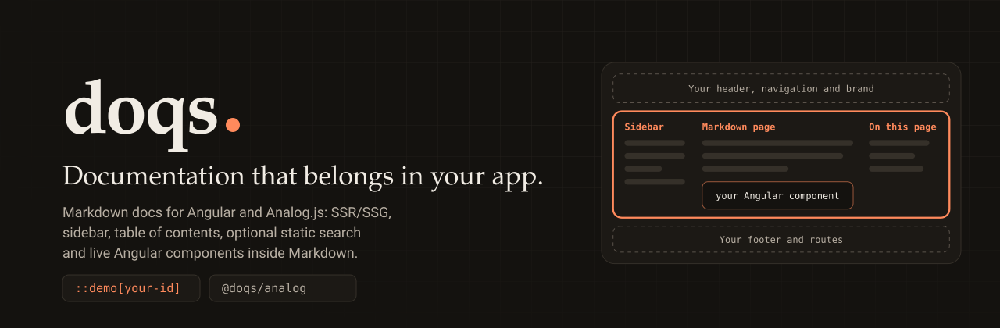

<div align="center">



<br />

**Markdown documentation for your existing Angular and Analog.js app — your header, footer, routes, theme and components stay yours.**

SSR/SSG, sidebar, table of contents, optional static search and live Angular components inside Markdown.

<br />

[](https://www.npmjs.com/package/@doqs/analog)
[](https://angular.dev)
[](https://analogjs.org)
[](https://github.com/Andersseen/doqs/actions/workflows/ci.yml)
[](./LICENSE)

<br />

**[📦 npm package](https://www.npmjs.com/package/@doqs/analog)** · **[📖 Integration guide](packages/doq/README.md)** · **[📝 Changelog](packages/doq/CHANGELOG.md)** · **[🧭 Specifications](docs/specs/README.md)** · **[🤝 Contributing](CONTRIBUTING.md)**

</div>

---

## What is Doqs?

Doqs (`@doqs/analog`) adds a Markdown-driven **documentation region** to an Angular and Analog.js application you already have. It owns documentation routing, navigation, the table of contents, the index, code blocks and optional full-text search, and nothing else: no global `html`/`body` styles, no router takeover, no theme of its own. Your product keeps its shell.

- **Native Angular and Analog.js.** Routes come from `doqRoutes()`, content from Analog's own content files, prerendering from `doqPrerenderRoutes()`.
- **Markdown-driven.** `title`, `group`, `order` and `slug` in frontmatter, nested folders, custom public URLs.
- **SSR and SSG.** Every page ships as static HTML and hydrates cleanly.
- **Angular components inside Markdown.** Register your own standalone components once, then place them between paragraphs with a one-line `::demo[id]` directive. Not MDX: no JavaScript in Markdown and no template compilation.
- **Interactive playgrounds.** Register a component with a few typed controls (`boolean`, `string`, `number`, `select`) and place it with `::playground[id]`: readers change its inputs, watch selected outputs, resize the preview, expand it, reset it and copy usage code. Server-rendered, hydrated, keyboard-operable.
- **Rich Markdown, built in (0.4).** `> [!NOTE]` callouts, accessible `:::tabs` and code groups, `:::steps` guides and titled code blocks, with no component to write. They are server-rendered, searchable and themed by the same `--host-docs-*` tokens. See [Rich Markdown authoring](apps/site/src/content/docs/guides/rich-markdown.md).
- **API reference from source (0.5).** `doq-api generate` reads your library's public TypeScript API (components, directives, signal inputs, outputs, models, JSDoc, stability tags) and writes ordinary Markdown pages; `doq-api check` fails CI when they are stale. Build-time only, with your own TypeScript. See [API reference from source](apps/site/src/content/docs/guides/api-reference.md).
- **Versioned documentation (0.6).** Keep older releases readable: archived snapshots at stable `/v/<id>` URLs, an accessible version selector, context-preserving switching, per-version prerendering and Pagefind filtering. Optional; without `versioning` nothing changes. See [Versioned documentation](apps/site/src/content/docs/guides/versioned-documentation.md).
- **Static search.** Optional [Pagefind](https://pagefind.app) index built from your prerendered output. No backend, off by default.
- **Host-owned look.** Restyle with `--host-docs-*` CSS tokens and add your own components through composition slots.

## Quick start

```sh
pnpm add @doqs/analog @analogjs/content @analogjs/router prismjs
```

```sh
pnpm exec doq init      # scaffolds src/doq.paths.ts and two Markdown pages; never overwrites; --dry-run previews
pnpm exec doq doctor    # reports what is connected and what is missing
```

`doq init` prints the exact edits that remain for your `vite.config.ts`, Angular providers and global stylesheet. They are the same four connections described in the [Analog configuration guide](apps/site/src/content/docs/analog-configuration.md); the rest of the documentation (installation, Markdown, search, versions, API reference, deployment, troubleshooting) is in [`apps/site/src/content/docs`](apps/site/src/content/docs), which the official site renders with Doqs itself.

## Two ways to use it

Both are real applications in this repository, built and tested in CI.

| Scenario                                       | Showcase                                                   | `basePath` | What it proves                                                                                                                                     |
| ---------------------------------------------- | ---------------------------------------------------------- | ---------- | -------------------------------------------------------------------------------------------------------------------------------------------------- |
| **Docs inside a product site**                 | [`apps/showcase-a`](apps/showcase-a) (Vanta UI)            | `/docs`    | The host keeps its landing page, header, footer and theme; Doqs owns one route. Left sidebar, TOC, search, demos and slots.                        |
| **Docs-first site** (Starlight or ngDoc style) | [`apps/showcase-b`](apps/showcase-b) (ForgeCMS Developers) | `/`        | The whole application is documentation: `DoqShellComponent` provides the shell, Doqs owns every route. Right sidebar, custom slugs, search, demos. |

The packed tarball is also installed into a separate consumer project outside the workspace and verified from there (`pnpm consumer:build`).

## Repository

| Path              | What it is                                                                                                                                                                                                                                    |
| ----------------- | --------------------------------------------------------------------------------------------------------------------------------------------------------------------------------------------------------------------------------------------- |
| `packages/doq`    | `@doqs/analog`, the Angular library (ng-packagr, partial compilation)                                                                                                                                                                         |
| `apps/showcase-a` | Product site with Doqs on `/docs`                                                                                                                                                                                                             |
| `apps/showcase-b` | Docs-first site with Doqs at `/`                                                                                                                                                                                                              |
| `apps/site`       | The official website, built with Analog.js, Tailwind CSS 4, [Volt UI](https://github.com/Andersseen/volt-ui), [Lumen Icons](https://github.com/Andersseen/lumen-icons) and [Angular Movement](https://github.com/Andersseen/angular-movement) |
| `e2e`, `tests`    | Playwright (production builds), Vitest and Angular Testing Library, pytest contract tests on the packed tarball                                                                                                                               |
| `scripts`, `docs` | Node-run TypeScript tooling (preview server, CDP harness, SDD commands), specifications and operations runbooks                                                                                                                               |

## Development

Tested with Node 22.23.1, pnpm 10.18.3, Analog 2.9, Angular 21.2.x, TypeScript 5.9.3 and Vite 8. Angular 22.2.x with TypeScript 6 is verified by `pnpm verify:compat --angular=22` (focused smoke suite, not the full suite); Firefox and WebKit by `pnpm test:e2e:browsers` (the engine-dependent journeys). Details and limits: [Verified environments](apps/site/src/content/docs/reference/migration-and-compatibility.md).

```sh
pnpm install
pnpm dev:a        # showcase A; also dev:b and dev:site
pnpm build
pnpm pack:doq     # artifacts/doqs-analog-<version>.tgz; does not publish
pnpm verify:change   # fast local gate
pnpm quality:gate    # full pre-PR gate: static checks, unit, component, builds, package, contract, E2E, MVP harness
```

| Layer                   | Command                                                                               | Proves                                                                                                        |
| ----------------------- | ------------------------------------------------------------------------------------- | ------------------------------------------------------------------------------------------------------------- |
| Vitest unit             | `pnpm test:unit`                                                                      | paths, slugs, ordering, config defaults, SDD checker                                                          |
| Angular Testing Library | `pnpm test:components`                                                                | rendered component behavior by role, label and text                                                           |
| Playwright E2E          | `pnpm test:e2e`                                                                       | real-browser journeys on production builds                                                                    |
| Playwright browsers     | `pnpm test:e2e:browsers`                                                              | the engine-dependent journeys in Firefox and WebKit                                                           |
| pytest contract         | `pnpm test:contract`                                                                  | the packed tarball and the generated static HTTP output                                                       |
| Static / compat / perf  | `pnpm docs:check`, `pnpm verify:compat`, `pnpm verify:determinism`, `pnpm perf:check` | heading ids, links and canonicals of the output; Angular 21/22 consumers; repeated clean builds; size budgets |
| CDP harness             | `pnpm verify:mvp`                                                                     | the 24-criterion MVP and 0.1 acceptance run                                                                   |

Changes follow spec-driven development: see [CONTRIBUTING.md](CONTRIBUTING.md) and [docs/specs](docs/specs/README.md). Releases and the official site deployment are described in [docs/operations/release-and-deployment.md](docs/operations/release-and-deployment.md); the preview server serves `dist/analog/public`, and production hosts configure their own 404 behavior.

## License and community

MIT, see [LICENSE](LICENSE). [Contributing](CONTRIBUTING.md) · [Code of Conduct](CODE_OF_CONDUCT.md) · [Security](SECURITY.md) · [Support](SUPPORT.md) · [Verification harness](scripts/verification/README.md).
